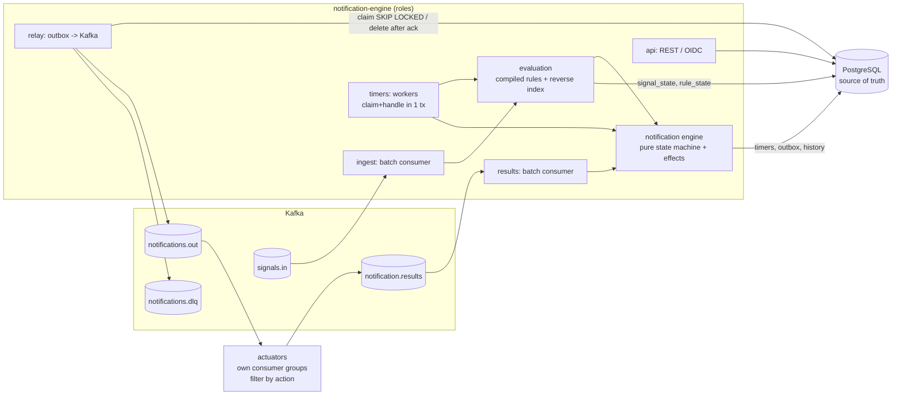
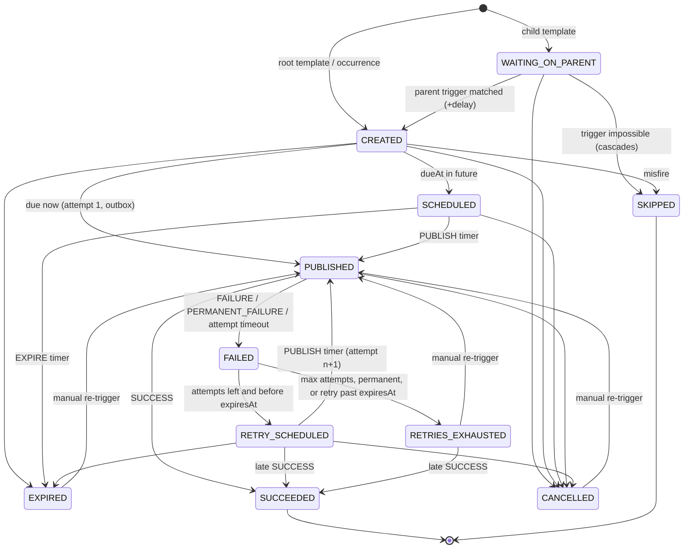

# Signal-driven notification engine

A Quarkus service that evaluates **rules over signals**. When a rule's activation expression becomes true, it **creates
notifications** and publishes them, exactly once per activation, to **one Kafka topic** (`notifications.out`). External
actuators (selected by `action`) deliver them and report outcomes on `notification.results`. The engine handles
scheduling, retries, expiry, recurring series and parent/child chains. PostgreSQL is the source of truth.

* Java 21 · Quarkus 3.33 LTS · PostgreSQL 16 · Kafka · plain JDBC · Flyway · Micrometer/Prometheus · OpenTelemetry · OIDC
* Business logic in **pure functions** (`domain.*`), unit-tested without any framework; services, transactions (JTA) and
  adapters on Quarkus, integration-tested with `@QuarkusTest` against real PostgreSQL and Kafka (Testcontainers); a load test.
* Measured at **1,000 publishes/s**: `timers.lag` p95 4 ms / p99 8 ms with Kafka. A burst drains at about 9,400 msg/s.
  See [load test](#load-test).

---

## Contents
1. [Quick start](#quick-start)
2. [Architecture](#architecture)
3. [Folder structure](#folder-structure)
4. [Notification state machine](#notification-state-machine)
5. [Data model](#data-model)
6. [Timer design](#timer-design)
7. [Topics and message schemas](#topics-and-message-schemas)
8. [Rule reference](#rule-reference)
9. [Service configuration reference](#service-configuration-reference)
10. [REST API](#rest-api)
11. [Observability](#observability)
12. [Scaling notes](#scaling-notes)
13. [Runbook](#runbook)
14. [Load test](#load-test)
15. [Semantics and design decisions](#semantics-and-design-decisions)
16. [Acceptance criteria → tests](#acceptance-criteria--tests)
17. [Known limitations](#known-limitations)

---

## Quick start

Requirements: **JDK 21** and **Docker** (for Testcontainers and the local stack). Maven is provided by `./mvnw`.

```bash
# all tests: unit + PostgreSQL/Kafka integration (Testcontainers) + full-stack @QuarkusTest
./mvnw verify

# local stack: PostgreSQL, Kafka (KRaft), engine, fake actuator
./mvnw package -DskipTests
docker compose up -d --build
./scripts/demo.sh                      # creates the example rule, sends signals, shows notifications + a dry-run
open http://localhost:8080/q/swagger-ui
docker compose --profile tracing up -d # optional Jaeger; then set OTEL_SDK_DISABLED=false for the engine

# load test (opt-in; ~4 min): in-memory broker, or real Kafka with -Dload.kafka=true
./mvnw verify -Pload -Dload.rate=1000 -Dload.seconds=60
```

The compose stack runs with **API auth disabled** (`NOTIFICATIONS_API_AUTH_ENABLED=false`, `API_AUTH_POLICY=permit`)
because it has no OIDC provider. In every other environment, configure `OIDC_AUTH_SERVER_URL`.

---

## Architecture

One deployable; **roles by config** (`notifications.roles=ingest,timers,relay,results,api`). Any instance can run any
subset. Each Kafka channel is enabled only on instances with the matching role (`RolesConfigSourceFactory`), so a
`timers,relay` instance never joins the signal consumer group. Instances are stateless. All coordination goes through
PostgreSQL (row locks, `FOR UPDATE SKIP LOCKED`) and Kafka (keys and partitions).



**Layers.** Enforced by `ArchitectureTest`.

| Layer | Package | Contents |
|---|---|---|
| Domain (pure functions: no framework, no I/O, no clock/random access, no mutable static state) | `domain.*`, `common.*` | expression compiler/evaluator + text DSL, cron/period recurrence, rule parser/validator, **state machine**, dependency matrix, body resolver, firing planner (shared by real processing and dry-run) |
| Core (Quarkus CDI beans, JTA transactions, plain JDBC) | `core.*` | repositories (set-based SQL), transactional services (signal ingestion, timers, outbox relay, results, rules, operator commands, maintenance) that load state, call the pure domain functions and persist their effects. No Kafka, JPA, Micrometer or OpenTelemetry: those sit behind ports |
| Adapters (Quarkus) | `infra.*` | SmallRye Kafka consumers, idempotent Kafka producer, REST resources, CDI producers, scheduled jobs, Micrometer/OTel adapters, health |

**Signal path, one transaction per Kafka batch.**
1. Bulk inbox insert (`ON CONFLICT DO NOTHING`) for idempotency on `signal_id`.
2. Reduce to the latest value per (tenant, key, signal), then bulk upsert `signal_state` where `excluded.occurred_at > occurred_at`.
3. Cancel events.
4. Lock `rule_state` rows in key order.
5. Evaluate the rules found through the reverse index, in memory.
6. Batched flush: rule states, RULE_EVAL timers, notifications, history, timers, outbox.
7. Commit, then commit the offsets.

If the batched flush fails, it is retried per entity under savepoints, and only the poison entity is dead-lettered.

**Results path.** A batch consumer locks the notifications in id order and validates attempt and action. It then
applies the state machine and flushes the effects (retry timer, children, series) in the same transaction.

### Transactions

Transactions are managed by Quarkus (Narayana JTA). Agroal enlists the JDBC connection in the current transaction.

* **Boundaries.** `@Transactional` marks the service entry points: `SignalIngestService.ingest`,
  `TimerService.runOnce`, `OutboxRelay.relayOnce`, `ResultService.process`, the `RuleService` writes and
  the operator commands of `NotificationEngine` (cancel, re-trigger, requeue). Retention needs several short transactions in one call, so it uses
  `QuarkusTransaction.requiringNew()` through `Db.inNewTx`.
* **Data access.** Repositories use plain JDBC on the enlisted connection via `Db.with`. Hot paths have no ORM.
* **Per-item isolation.** Timer handlers and batch fallbacks run under SQL savepoints (`SAVEPOINT` /
  `ROLLBACK TO SAVEPOINT`). Agroal forbids `Connection.rollback(Savepoint)` on an enlisted connection, and SQL
  savepoints are the supported equivalent on PostgreSQL. `ReliabilityIntegrationTest` checks that a SQL error inside a
  savepoint is isolated and that the rest of the transaction commits.
* **After-commit hooks** (waking local timer workers, refreshing the rule registry) are registered with the JTA
  `TransactionSynchronizationRegistry`, so a rollback drops them.
* **Failures.**
  * A runtime exception or `Error` rolls the whole transaction back. The worker loops and the Kafka consumers retry.
  * Deadlocks (`40P01`) are retried the same way.
  * A simulated kill mid-batch is covered by `crashMidBatchLosesNothing`.

### Pure business functions

Every business decision is a pure function in `domain.*` and is unit-tested without Quarkus or a database. The core
only loads state, calls these functions and persists the effects they return.

| decision | pure function | unit test |
|---|---|---|
| expression truth, MISSING/stale, `for`/`within`, next change instants | `Evaluator`, `ExpressionCompiler`, `DslParser` | `ExpressionTest` |
| firing (edge / cooldown), new rule state, per-entity timer | `RuleEvaluation` (`FiringDecision`, `Result.nextState/entityTimer`) | `RuleEvaluationTest` |
| notifications to create, due/expiry, resolved bodies (shared with dry-run) | `FiringPlanner`, `BodyResolver` | `BodyResolverTest`, `LifecycleIntegrationTest.dryRunEqualsRealProcessing` |
| signal idempotency, unreferenced filter, latest value, `$trigger` choice | `Signals.SignalBatch` | `SignalBatchTest` |
| notification lifecycle, retries/backoff, late outcomes, re-trigger | `StateMachine`, `Rule.RetryPolicy` | `StateMachineTest` |
| child activation / skip, WHILE_IN_STATE series | `StateMachine.Dependencies` | `DependencyMatrixTest` |
| recurring occurrence: parent re-check, limits, misfire, next due | `SchedulingPolicies.SeriesStep` | `SeriesStepTest` |
| outcome parsing and correlation (tenant / action) | `Lifecycle.OutcomeMessage` | `MessagesAndRetentionTest` |
| output message contract (key, headers, payload) | `Lifecycle.NotificationMessage` | `MessagesAndRetentionTest` |
| timer failure backoff / timer_dead, sweep continuation | `SchedulingPolicies.TimerFailurePolicy`, `.SweepStep` | `TimerAndSweepTest` |
| recurrences (cron, periods, DST) | `Recurrence` (`CronRecurrence`, `PeriodRecurrence`) | `RecurrenceTest` |
| rule validation (paths, cycles, depth) | `RuleParser` | `RuleParserTest` |
| partition retention | `SchedulingPolicies.RetentionPolicy` | `MessagesAndRetentionTest` |

`ArchitectureTest` enforces the following for `domain` and `common`:
* no framework imports;
* no I/O;
* no clock or random access (time and randomness are passed in as parameters);
* no mutable static state.

It also enforces that `core` uses neither Kafka, JPA, Micrometer nor OpenTelemetry.

### Test strategy

| level | how | profile |
|---|---|---|
| unit | plain JUnit on the pure functions (≈100 tests, < 1 s) | – |
| engine integration | `@QuarkusTest` with real PostgreSQL; `MutableClock` and `RecordingPublisher` are CDI alternatives; no background workers, consumers or jobs, so tests drive ingestion, timers, relay and results explicitly | `CoreProfile` |
| end-to-end | `@QuarkusTest`, all roles, real clock, Kafka + PostgreSQL, REST with `@TestSecurity` | `EndToEndProfile` |
| load | `@QuarkusTest`, real worker loops, measuring broker (or real Kafka) | `LoadProfile` (`-Pload`) |

---

## Folder structure

```
├── pom.xml, mvnw, .mvn/              Maven build (Quarkus 3.33.4 LTS, Java 21)
├── Dockerfile, docker-compose.yml    JVM image; local stack (Postgres, Kafka, engine, fake actuator, optional Jaeger)
├── schemas/                          JSON Schemas of all messages + COMPATIBILITY.md
├── scripts/demo.sh, example-rule.json
├── docs/openapi/openapi.{yaml,json}  generated OpenAPI spec (written at build time)
├── docs/load-test-report.md
└── src/main/
    ├── resources/db/migration/V1__schema.sql   tables, partitioning function, indexes, autovacuum settings
    ├── resources/application.properties        service configuration (see reference below)
    └── java/trash_maker/            51 files: one file per concept, small types nested in it
        ├── common/        IsoAmount (+ Durations), Json, Validation (ValidationError, ValidationException)
        ├── domain/        pure functions only
        │   ├── notification/  Lifecycle (statuses, events, effects, transitions, failure, outcome and output messages)
        │   │                  StateMachine (+ Dependencies: parent/child matrix)
        │   ├── rule/          Rule (definition, trigger, templates, TimeSpec, RetryPolicy, enums, CompiledRule), RuleParser
        │   ├── expr/          Expr (Node tree, Op, Truth, input/result), ExpressionCompiler, Evaluator, DslParser
        │   ├── body/          BodyResolver (+ context, JsonPath, Transforms, schema port)
        │   ├── signal/        Signals (Value, SignalEnvelope, SignalValue, SignalBatch)
        │   ├── recurrence/    Recurrence (+ CronRecurrence, PeriodRecurrence; DST rules)
        │   ├── evaluation/    RuleEvaluation (single pipeline + FiringDecision), FiringPlanner (+ FrozenContext)
        │   └── scheduling/    SchedulingPolicies (SeriesStep, TimerFailurePolicy, SweepStep, RetentionPolicy)
        ├── core/          one package: CDI services, JTA transactions, JDBC
        │                  Engine (facade), EngineConfig, Ports (+ WakeupHub), Db, Jdbc (+ Uuid7), SchemaValidators,
        │                  SignalIngestService, SignalStore, EvaluationService (+ dry-run), RuleStateRepository,
        │                  NotificationEngine (+ operator commands), NotificationRepository, SeriesRepository,
        │                  TimerService (+ Worker loop), TimerRepository, Outbox (+ dead letters), OutboxRelay,
        │                  ResultService, RuleService, RuleRegistry, RuleRepository, Maintenance
        └── infra/         one package: Quarkus adapters
                           EngineProducer (+ Kafka producer, Micrometer and OpenTelemetry adapters), NotificationsConfig,
                           RolesConfigSourceFactory, KafkaConsumers, FakeActuator, RuleResource, NotificationResource,
                           OpsResource, ApiSupport (tenant guard, role filter, error mapping), Dtos, Workers (+ health), Jobs
src/test/java/trash_maker/
    domain/  plain JUnit on the pure functions (truth tables, recurrence/DST, state machine, backoff, body, rule validation,
             dependency matrix, signal batch, series step, timer policy, sweep, messages, retention, pipeline, architecture)
    it/      @QuarkusTest: Firing/Lifecycle/ReliabilityIntegrationTest (CoreProfile), EndToEndTest (EndToEndProfile)
    support/ CoreProfile, EndToEndProfile, shared Testcontainers, MutableClock + RecordingPublisher (CDI alternatives), Fx fixture
    load/    LoadTest + LoadProfile (@QuarkusTest, -Pload)
```

---

## Notification state machine

`StateMachine.apply(state, event, now) → Transition(newState, changes, effects)` is a pure function. The caller
applies the effects in the **same transaction**:
* `ScheduleTimer`
* `CancelTimers`
* `Emit` (writes an outbox row)
* children and series coordination, from the entered states
* append-only history

Two kinds of input are handled differently:
* **Illegal transitions throw.** For example, cancelling a SUCCEEDED notification. The API returns `409`.
* **Stale or duplicate inputs are ignored and counted.** For example, a late timer or a superseded outcome.



* **FAILED is transient.** It is always followed in the same transaction by RETRY_SCHEDULED or RETRIES_EXHAUSTED,
  and it is recorded in history.
* **Terminal states, for skip decisions:** SUCCEEDED, RETRIES_EXHAUSTED, CANCELLED, EXPIRED, SKIPPED.
* **Attempts.**
  * `attempt` is monotonic and is sent to actuators, who dedupe on `notification_id + attempt`.
  * `cycle_attempts` counts attempts against the retry budget. A manual re-trigger resets it.
* **Kafka publish errors are not attempts.** Rows stay in the outbox until the broker acknowledges them.

**Outcome handling.** A result is first matched to its notification by `notification_id` + `attempt` + `action`:
* An `action` mismatch → ignored, logged, metric `results.action_mismatch`.
* An unknown attempt → ignored.

Then, by outcome:
* `SUCCESS` for the current or any earlier attempt → SUCCEEDED, from PUBLISHED, RETRY_SCHEDULED or RETRIES_EXHAUSTED.
  This is how a "late SUCCESS" is accepted. Pending retry and timeout timers are deleted.
* `FAILURE` or `PERMANENT_FAILURE` for the current published attempt → the failure path. If it is for a superseded
  attempt → ignored.
* No outcome within `attemptTimeout` → failure with reason `TIMEOUT`. The timeout is armed when the Kafka ack arrives,
  and the timer is deleted by primary key when an outcome comes in.

### Parent/child dependency matrix

| child trigger | activates when the parent enters | skipped when the parent reaches terminal without it |
|---|---|---|
| ON_FAILED | FAILED (first failure; once) | yes |
| ON_RETRIES_EXHAUSTED | RETRIES_EXHAUSTED | yes |
| ON_SUCCEEDED | SUCCEEDED | yes |
| ON_PUBLISHED | PUBLISHED (first publish) | yes |
| ON_CANCELLED / ON_EXPIRED | CANCELLED / EXPIRED | yes |
| WHILE_IN_STATE (RECURRING only) | a series starts when the parent is in `states`; it is closed `PARENT_RECOVERED` (parent left the states, or SUCCEEDED) or `PARENT_TERMINATED` (CANCELLED/EXPIRED/SKIPPED). The parent's state is re-checked in the claim transaction before every occurrence. One active series per parent (unique index). Re-entering the states starts a new series unless `once`. Limits: `until` / `maxOccurrences` (mandatory) → `LIMIT_REACHED`. | — |

How children behave:
* Children are created together with their parent, in WAITING_ON_PARENT.
* A skip cascades to the skipped child's own children.
* `FAILED` in `states` also matches RETRY_SCHEDULED and RETRIES_EXHAUSTED, because FAILED is transient.

All of this is tested by `DependencyMatrixTest` and `LifecycleIntegrationTest`.

---

## Data model

All in `V1__schema.sql`. Timestamps are `timestamptz` in UTC.

| table | purpose / key points |
|---|---|
| `signal_inbox` | `(tenant_id, signal_id)` PK, for idempotency. Short retention. |
| `signal_state` | Latest value per `(tenant, key, signal)`. Updated only when `occurred_at` is newer. Index `(tenant, signal, key)` serves the sweeps. |
| `rule` | Immutable versions `(tenant, rule_id, version)`, one `current` per rule (partial unique). `change_seq` drives hot reload. |
| `rule_state` | `last_result`, `edge_seq`, `last_fired_at`, `leaf_state` (`for`/`within` memory) per (tenant, rule, key). Its row lock serializes evaluation per entity. |
| `notification` | **Range-partitioned monthly by `created_at`**. The id is a **UUIDv7 whose timestamp equals `created_at`**, so a lookup by id prunes to one partition. Children share their parent's `created_at`. Columns: status, attempt, cycle_attempts, retry_policy, resolved `body` (immutable), `spec` (template snapshot), `context` (frozen signals/trigger for deferred `$parent` parts), due_at, expires_at, attempt_timer_id, `version` (optimistic `UPDATE … WHERE version=?`). Indexes: (tenant,id), (tenant,key,id), (tenant,status,id), (tenant,due_at,id), parent, a partial index on cancellable rows, and terminal_at. |
| `notification_history` | Append-only, partitioned like `notification`, and dropped with it. |
| `notification_dedup` | Idempotency key `(tenant\|rule\|key\|edge_seq\|template)`. Short retention (7 days). |
| `recurring_series` | Top-level RECURRING series and WHILE_IN_STATE series (WAITING/ACTIVE/CLOSED, close_reason, limits, occurrences). |
| `timer` | `kind, due_at, notification_id, series_id, rule_id, correlation_key, payload, failures`. Index on `due_at`. **Partial unique index `(tenant, rule_id, correlation_key) WHERE kind='RULE_EVAL'`**. Aggressive autovacuum. |
| `timer_dead` | Timers that failed N times (runbook: inspect and requeue). |
| `outbox` | Small. Rows are deleted after the Kafka ack. Aggressive autovacuum. |
| `dead_letter` | Every DLQ event (also published to `notifications.dlq`). |

`ensure_monthly_partitions(from, monthsAhead)` creates partitions for the previous month up to N months ahead. It runs
at startup and daily. Retention runs hourly behind a cluster-wide advisory lock:
* deletes terminal notifications older than 30 days, in batches;
* drops whole monthly partitions (with their history partitions) once they hold no active rows;
* purges dedup, inbox, dead_letter, timer_dead and closed series.

`ReliabilityIntegrationTest.hotQueriesUseIndexes` verifies with `EXPLAIN` that the hot queries use indexes and prune
partitions.

---

## Timer design

Everything time-based is a row in `timer`:

| kind | key fields | handler |
|---|---|---|
| `PUBLISH` | notification_id | SCHEDULED/RETRY_SCHEDULED → PUBLISHED (or EXPIRED) |
| `ATTEMPT_TIMEOUT` | notification_id, payload.attempt | PUBLISHED with the same attempt → FAILED(TIMEOUT) → retry/exhausted |
| `EXPIRE` | notification_id | → EXPIRED if not yet published |
| `NEXT_OCCURRENCE` | series_id | re-check parent (WHILE_IN_STATE) and limits, misfire SKIP, create the occurrence, schedule the next |
| `RULE_EVAL` per entity | (rule, key) unique | re-evaluate when maxAge expires, `for`/`within` windows elapse, or NOW-relative comparisons cross |
| `RULE_EVAL` per rule (`key='*'`) | (rule) unique | NOW-based `dateMatches`: walk the rule's entities in keyset pages (cursor in payload, one page per firing), then schedule the next change instant |

* **Claim and handle in one transaction, with no leases:**
  `DELETE FROM timer WHERE id IN (SELECT id … WHERE due_at <= now ORDER BY due_at LIMIT n FOR UPDATE SKIP LOCKED) RETURNING *`.
  A crash rolls back the transaction and the timers reappear. Two workers can never run the same timer.
* **Batched fast path.** Notification timers in a batch lock all their notifications at once (sorted, so no deadlocks).
  Transitions are computed in memory and written with one batched statement per table.
* **Failure isolation.** If the fast path fails, every timer is handled again individually under a **SQL savepoint**. A
  failing handler is rolled back on its own and re-inserted with exponential backoff (`failure-backoff × 2^failures`).
  After `max-failures` it moves to `timer_dead`, and the rest of the batch still commits.
* **Handler rules.** Handlers are idempotent and guarded by state (a stale timer is ignored), and they make no remote
  calls. The only output to Kafka goes through the outbox.
* **Worker loop.** Virtual threads, `notifications.timers.workers` per instance. When idle, a worker sleeps until the
  next `due_at`, bounded to 100–500 ms. A commit that writes a timer due within `idle-max` wakes the local workers
  through after-commit hooks. Polling is the source of truth: there are no in-memory timers per entity.
* **Next-change instants.** The evaluator returns `nextEntityChange` and `nextRuleChange`: the earliest instants at
  which the result can change without any input. These keep the RULE_EVAL timers exact.

---

## Topics and message schemas

| topic | key | producer → consumer | schema |
|---|---|---|---|
| `signals.in` (configurable) | `tenant_id + correlation_key` | sources → engine (`ingest`) | `schemas/signal-v1.json` |
| `notifications.out` | `tenant_id:notification_id` | engine (outbox relay, idempotent producer, acks=all) → actuators | `schemas/notification-v1.json`; headers `action`, `tenant_id`, `notification_id`, `attempt`, `schema_version`, W3C `traceparent` |
| `notification.results` | `tenant_id:notification_id` | actuators → engine (`results`) | `schemas/notification-result-v1.json` |
| `notifications.dlq` | tenant | engine → operators | `schemas/dead-letter-v1.json` |

Compatibility rule: additive-only within a major version, and consumers ignore unknown fields. See
`schemas/COMPATIBILITY.md`. Actuators use **their own consumer groups**, filter by the `action` header, and dedupe on
`notification_id + attempt`.

---

## Rule reference

```json
{ "id":"r1", "tenantId":"acme", "enabled":true, "timezone":"Europe/Rome", "onMissingValue":"FAIL",
  "trigger":{"mode":"ON_BECOMES_TRUE","onMissing":"FALSE","expression":{ ... } | "expressionText":"..."},
  "templates":[ ... ] }
```
`version` is assigned by the API: POST creates v1 and PUT creates v+1. Rules are hot-reloaded across instances (polled
`change_seq`, plus a full reload every 5 minutes). Existing notifications keep their frozen bodies and template
snapshots. Validation happens at save time and returns precise JSON paths (`400 {errors:[{path,message}]}`).

### Expressions
| node | JSON | DSL |
|---|---|---|
| and / or / not | `{"and":[…]}` `{"or":[…]}` `{"not":{…}}` | `a and b`, `a or b`, `not a`, `( … )` |
| comparison | `{"signal":"kpi1","op":">","value":5}` with ops `= != > >= < <= in between` | `kpi1 > 5`, `s in ['A','B']`, `x between [1, 10]` |
| vs another signal | `{"signal":"a","op":"<","valueSignal":"b"}` | `a < signal(b)` |
| vs NOW (DATE signals) | `{"signal":"due","op":"<=","value":{"now":"P3D"}}` | `due <= now + P3D` |
| options | `"maxAge":"P1D"` (older ⇒ MISSING), `"for":"PT10M"` (true continuously for), `"within":"PT1H"` (true at some point in the last…) | `… maxAge P1D`, `… for PT10M`, `… within PT1H` |
| dateMatches | `{"dateMatches":{"source":"NOW"\|"due_date","recurrence":{"cron":"0 0 1 * *"}\|{"every":"P1M","anchor":"2024-01-31T09:00"},"timezone":"…","tolerance":"PT1H"}}` | `dateMatches(NOW, cron '0 0 1 * *', tolerance PT1H)`, `dateMatches(due, every P1M anchor '2024-01-31')` |

* **dateMatches** is true when an occurrence `o` satisfies `o ≤ t < o + tolerance`. `t` is NOW or the DATE signal.
  With tolerance 0 (the default for signal sources), `t` must equal `o` exactly. NOW sources default to PT1M and must
  be > 0. Cron uses 5 fields, `L` = last day of month, names, ranges and steps.
* **DST.** A local time inside a spring-forward gap fires at the first instant after the gap. A time repeated by a
  fall-back overlap fires once.
* **MISSING** means never received, stale, or not comparable (type mismatch). `trigger.onMissing`:
  * `FALSE` (default): the leaf is false.
  * `TRUE`: the leaf is true.
  * `UNKNOWN`: Kleene three-valued logic, and an unknown final result counts as false.
* **Firing modes.**
  * `ON_BECOMES_TRUE` (default) fires on false→true and re-arms on false.
  * `EVERY_EVALUATION_TRUE` requires `cooldown`.
  * Every firing increments `edge_seq`, and the idempotency key is `tenant|rule|key|edge_seq|template`.
* **Limits.** Depth 16, 256 nodes, 1,000 values in an `in` list, 32 templates, parent chain depth 5. Expressions are
  compiled once per version. Evaluation is pure, with no reflection or scripting.

### Templates
| field | meaning |
|---|---|
| `id`, `type` | `IMMEDIATE`, `SCHEDULED`, `RECURRING` |
| `action` | `[A-Z0-9_.-]{1,64}`, optional allow-list (`notifications.actions.allow-list`) |
| `dueAt` | TimeSpec `{"from":"NOW"\|"$signal:due_date","offset":"-P3D","atTime":"09:00"}` (rule time zone) |
| `dueAtFloor` | `"NOW"`: a due time in the past publishes immediately |
| `expiresAt` | TimeSpec, or an ISO amount relative to `dueAt` (`"P1D"`). No publish or retry after it. |
| `every` / `cron`, `startAt`, `until`, `maxOccurrences`, `misfirePolicy`(`SKIP`), `misfireGrace` | RECURRING. `until` is a TimeSpec or an amount after the start. Each occurrence is its own notification, with `series_id` and `occurrence_index`. |
| `cancelOnEvents` | Signal names that cancel this template's active notifications or series for the same correlation_key. |
| `retryPolicy` | `maxAttempts` (total, default 1), `backoff` FIXED\|EXPONENTIAL, `initialDelay`, `multiplier`, `maxDelay`, `jitter` (fraction), `attemptTimeout`. Delay before retry n = `min(initialDelay × multiplier^(n−1), maxDelay) ± jitter`. |
| `parent` | `{"templateId","trigger","delay"}`. For WHILE_IN_STATE add `"states"`, `"until"`\|`"maxOccurrences"`, `"once"`. Same rule only, no cycles, depth ≤ 5, a RECURRING template cannot be a parent. |
| `body`, `bodySchema`, `onMissingValue` | See below. |

### Body population
Each JSON value is one of:
* a literal;
* a reference: `{"$signal":"kpi1"}` (state snapshot at firing), `{"$trigger":"$.signal"}` (the message that caused the
  evaluation; absent for time-triggered ones), `{"$parent":"$.lastFailure.reason"}`, `{"$builtin":"correlationKey"|"now"|"occurrence.index"|"ruleId"|"templateId"}`,
  `{"$coalesce":[…]}`, or `{"$literal":{…}}` as an escape;
* a string template: `"Reminder ${correlationKey} due ${signal.due_date|date:'dd/MM/yyyy'}"`.

Reference options are `"required"`, `"default"`, and `"transform"`. Whitelisted transforms: `date:'pattern'`,
`number:'pattern'`, `upper`, `lower`, `capitalize`, `trim`, `default:'x'`.

`onMissingValue` (rule level, overridable per template):
* `FAIL` (default): the whole firing is rejected and the event goes to the DLQ. No partial set is created.
* `USE_DEFAULT`: the value becomes `null`, or `""` inside a string template.
* `OMIT_FIELD`: the field is dropped.

Bodies are resolved once at creation and stored immutable. `$parent` parts are resolved when the child activates, or
at each WHILE_IN_STATE occurrence, from a frozen snapshot of the firing's signals, and are then frozen. Bodies are
limited to 256 KB and checked against `bodySchema` (JSON Schema 2020-12, no remote `$ref`) when one is set. No code is
executed and no remote calls are made.

---

## Service configuration reference

All keys can be set via environment variables (`NOTIFICATIONS_TIMERS_WORKERS=4`, …).

| key | default | meaning |
|---|---|---|
| `notifications.roles` | `ingest,timers,relay,results,api` | roles of this instance (`fake-actuator` for demos) |
| `notifications.topics.signals/results/out/dlq` | `signals.in` / `notification.results` / `notifications.out` / `notifications.dlq` | topic names (never in rules) |
| `notifications.signals.store-unreferenced-signals` | `false` | keep signals no rule references (otherwise discarded + `signals.unreferenced` metric) |
| `notifications.signals.default-max-age` | – | global staleness (leaf `maxAge` overrides) |
| `notifications.actions.allow-list` | – | allowed actions in rules |
| `notifications.ingest.consumers` / `notifications.results.consumers` | `2` / `2` | consumer threads per instance (≤ partitions) |
| `notifications.timers.workers` / `batch-size` | `2` / `200` | timer worker threads and claim size |
| `notifications.timers.max-failures` / `failure-backoff` | `5` / `PT1S` | handler retries before `timer_dead` |
| `notifications.timers.idle-min` / `idle-max` | `PT0.1S` / `PT0.5S` | idle sleep bounds |
| `notifications.timers.sweep-page-size` | `500` | entities per page for NOW-based rule sweeps |
| `notifications.relay.workers` / `batch-size` / `idle` | `1` / `500` / `PT0.05S` | outbox relay |
| `notifications.rules.refresh-interval` | `2s` | hot reload poll |
| `notifications.retention.terminal-notifications` / `dedup` / `inbox` / `partitions-ahead` / `interval` | `P30D` / `P7D` / `P7D` / `3` / `1h` | retention |
| `notifications.api.auth-enabled` / `admin-role` / `tenant-role-prefix` | `true` / `admin` / `tenant:` | API authorization (roles from the JWT claim `OIDC_ROLE_CLAIM`, default `groups`) |
| `notifications.kafka.producer.extra` | – | extra producer props `k=v,k=v` (e.g. SASL) |
| `notifications.fake-actuator.*` | `actions=*`, `failure-rate=0.1`, `permanent-failure-rate=0.02`, `silent-rate=0.02` | demo actuator |
| env `DB_URL`, `DB_USER`, `DB_PASSWORD`, `DB_POOL_MAX`, `KAFKA_BOOTSTRAP_SERVERS`, `OIDC_AUTH_SERVER_URL`, `API_AUTH_POLICY`, `LOG_JSON`, `OTEL_SDK_DISABLED`, `OTEL_EXPORTER_OTLP_ENDPOINT` | | infrastructure |

---

## REST API

OpenAPI: `docs/openapi/openapi.yaml`, generated at build. It is also served live at `/q/openapi`, with Swagger UI at
`/q/swagger-ui`. Every endpoint is tenant-scoped. The caller needs the `admin` role or `tenant:<id>`; otherwise `403`.

| method & path | purpose |
|---|---|
| `GET/POST /api/v1/tenants/{t}/rules`, `GET/PUT /rules/{id}`, `GET /rules/{id}/versions`, `POST /rules/{id}/enable\|disable` | rule CRUD with versions |
| `POST /rules/validate` | validation with precise error paths |
| `POST /rules/dry-run` | `{rule \| ruleId, correlationKey, signals:{name:{kind,value,occurredAt}}, now, trigger, priorState}` returns the truth value of every node, the decision, next change instants, and the notifications and series with resolved bodies. It uses the same pipeline as real processing. |
| `GET/DELETE /rules/{id}/state/{key}` | inspect or reset rule state |
| `GET /notifications?status&action&correlationKey&ruleId&dueFrom&dueTo&cursor&limit` | keyset search |
| `GET /notifications/{id}`, `/history`, `POST /cancel`, `POST /retrigger` | |
| `GET /series/{id}`, `POST /series/{id}/cancel` | |
| `GET /entities/{key}/signals`, `/entities/{key}/rules` | inspect signal and rule state |
| `GET /api/v1/ops/stats`, `GET /ops/timers/dead`, `POST /ops/timers/dead/requeue`, `POST /ops/retention/run`, `POST /ops/partitions/ensure` | runbook (admin) |

---

## Observability

* **Logs.** JSON (`quarkus-logging-json`), with MDC fields `tenant_id`, `notification_id`, `timer_id`, `timer_kind`,
  `series_id`, plus `traceId`/`spanId` from OpenTelemetry. **Resolved bodies are never logged.**
* **Metrics** (`/q/metrics`, prefix `notif_`). Tags are bounded: `action`, `kind`, `to`, `outcome`, `reason` codes.
  * Timers: `timers_lag_ms` (p50/p95/p99, by kind), `timers_fired|failed|dead_total`, `timers_pending{kind}`,
    `timers_oldest_due_lag_ms`, `timers_dead_total`.
  * Outbox: `outbox_publish_lag_ms`, `outbox_size`, `outbox_oldest_age_ms`, `outbox_publish_errors_total`.
  * Notifications: `notifications_published_total{action}`, `notifications_retries_total`,
    `notifications_exhausted_total`, `notifications_transitions_total{to,action}`, `notifications_created_total`.
  * Signals: `signals_received|duplicate|unreferenced|invalid|out_of_order_ignored_total`.
  * Rules and evaluation: `evaluation_time_ms`, `rules_fired_total`, `rules_fire_failed_total{reason}`.
  * DLQ and results: `dlq_events_total{source,reason}`, `dlq_last24h`, `results_outcome_total{outcome,action}`,
    `results_action_mismatch_total`.
* **Tracing.** OpenTelemetry covers REST and Kafka. The W3C trace context is captured when a message is written to the
  outbox and sent as Kafka headers on `notifications.out`. Enable it with `OTEL_SDK_DISABLED=false`.
* **Health.**
  * `/q/health/live`: the engine workers are alive.
  * `/q/health/ready`: the datasource and Kafka channels are ready.

---

## Scaling notes

* **Partitions.** `signals.in` and `notification.results` need at least `instances × consumers` partitions (the compose
  file uses 12). The key `tenant+correlation_key` spreads a hot tenant over all partitions while keeping each entity
  ordered. Size for peak signals/s ÷ (~5,000 signals/s per instance measured with batches of 500).
* **Per-entity serialization.** Kafka key order plus `rule_state` row locks, taken in key order. Timers and results
  lock notifications in id order.
* **Timers and relay** scale horizontally (SKIP LOCKED). One instance with 4 workers sustained 1,000 publishes/s with
  p99 lag under 50 ms and drained bursts at about 5,000/s. Add `timers,relay` instances for headroom. PostgreSQL is
  the shared bottleneck: watch CPU, WAL and autovacuum on `timer`/`outbox`.
* **Hot tenants.** The signal key spreads load across partitions, so one tenant cannot block a partition. Timers are
  served in global `due_at` order. A single tenant's burst of N timers delays others by roughly N ÷ drain rate (≈ 6 s
  for 30,000). Actuators use **separate consumer groups per actuator**, so a slow SMS gateway does not delay email.
  Per-tenant quotas are not implemented (see limitations).
* **DB.** Use a connection pool of about workers + consumers + relays + 10. Monthly partitions keep indexes small, and
  retention drops whole partitions instead of deleting rows.

---

## Runbook

| symptom | check | action |
|---|---|---|
| `timers_oldest_due_lag_ms` rising | `GET /api/v1/ops/stats`, `timers_pending{kind}` | add `timers` workers or instances; check DB CPU and locks (`pg_stat_activity`) |
| `outbox_oldest_age_ms` rising, `outbox_publish_errors_total` > 0 | broker health, producer logs | fix Kafka. Rows stay and are retried with backoff, and no attempts are consumed. Scale `relay` if healthy but slow. |
| `timers_dead_total` > 0 | `GET /api/v1/ops/timers/dead` (`last_error`, failures) | fix the cause (bad data or bug), then `POST /api/v1/ops/timers/dead/requeue {"ids":[…]}` |
| DLQ events (`dlq_events_total{reason}`) | `dead_letter` table or `notifications.dlq` | `INVALID_MESSAGE`: fix the producer. `BODY_RESOLUTION_FAILED`/`TIME_BASE_MISSING`: the signal arrived after the firing, or the rule needs `default`/`USE_DEFAULT`. Fix and replay the signal with a new `signal_id`, or reset state (`DELETE /rules/{id}/state/{key}`). |
| partitions missing (insert errors "no partition") | `\d+ notification` | `POST /api/v1/ops/partitions/ensure?monthsAhead=6` (it also runs at startup and daily) |
| consumer lag on `signals.in` | consumer group lag | increase partitions, then `notifications.ingest.consumers`, then instances |
| rule misbehaves | `POST /rules/dry-run` with the entity's signals (`GET /entities/{key}/signals`) | `PUT` a fixed version or `POST /rules/{id}/disable`. Notifications already created are unaffected. |
| stuck notification | `GET /notifications/{id}` and `/history` | `POST /cancel` or `POST /retrigger` |

---

## Load test

`./mvnw verify -Pload` (`LoadTest`, a `@QuarkusTest` with `LoadProfile`). The application runs its real timer workers
(4) and outbox relays (2) on the real clock, with JTA transactions. Run on 4 vCPU with PostgreSQL 16 (Testcontainers, `fsync=off`) and Kafka 3.8. Full report:
`docs/load-test-report.md`.

| scenario | broker | published | throughput | `timers.lag` p95 / p99 | due → Kafka ack p95 / p99 |
|---|---|---|---|---|---|
| sustained 1,000/s for 60 s | Kafka | 60,000 / 60,000 | 999 msg/s | **4 / 8 ms** | 47 / 80 ms |
| sustained 1,000/s for 60 s | in-memory | 60,000 / 60,000 | 999 msg/s | 3 / 5 ms | 30 / 35 ms |
| burst: 30,000 due at the same instant | Kafka | 30,000 / 30,000 | **9,375 msg/s** drain | 2.9 / 3.0 s (queueing) | 3.0 / 3.1 s |
| signal ingest (3 signals per entity, batches of 1,500) | – | – | ~7,800–8,500 signals/s, ~2,700 notifications created/s | – | – |

The sustained rate leaves about 9× headroom before the drain limit. Precision stays well within the 1–2 s target.

---

## Semantics and design decisions

* **Batch coalescing.** Within one Kafka batch, rules are evaluated on the *latest* state of each entity. A transient
  flap inside one batch (true→false→true) is a single evaluation. This is what makes firing independent of arrival
  order and batching (`FiringIntegrationTest.anyArrivalOrderFiresExactlyOnce`, `sameResultInOneBatch`).
* **`for` / `within`** measure processing time (evaluation instants, with exact timers). They do not use `occurred_at`.
* **Context signals** (body and `dueAt` bases) must be present when the rule fires. Otherwise `FAIL` sends the event to
  the DLQ and the edge is consumed. Send context signals before the triggering one, or use `default`/`USE_DEFAULT`.
* **PUBLISHED** means "committed to the outbox". `ON_PUBLISHED` children activate then.
* **Cancel events** cancel active notifications and series of the templates that list them, for the same key,
  whatever the event's `occurred_at`. In a batch, cancellation runs before evaluation.
* **Rule creation does not backfill.** Existing entities are evaluated on their next signal, or at the next
  time-change instant for NOW rules.
* **Late SUCCESS after RETRIES_EXHAUSTED** moves the notification to SUCCEEDED, but does not resurrect children that
  were already activated or skipped.
* **Re-trigger** (from RETRIES_EXHAUSTED, CANCELLED or EXPIRED) publishes a new monotonic attempt with a fresh retry
  budget and clears `expiresAt`.
* **quarkus-cache is not used.** Compiled rules live in `RuleRegistry`, an immutable snapshot swapped on reload, which
  is cheaper than a per-call cache.
* **LISTEN/NOTIFY is not implemented.** Polling with local after-commit wake-ups already gives p99 lag under 50 ms.

## Acceptance criteria → tests

| criterion | evidence |
|---|---|
| `(kpi1 > 5 AND dateMatches) OR kpi2 = true` correct for every combination, any order; time conditions fire without input | `ExpressionTest.acceptanceTruthTable` (20 cases), `FiringIntegrationTest.anyArrivalOrderFiresExactlyOnce`, `timeConditionFiresWithoutInputAndReArms`, `staleSignalStopsMatchingWithoutInput` |
| each false→true creates notifications exactly once, even with duplicates | `onBecomesTrueFiresOnceAndReArms`, `sameResultInOneBatch`, `redeliveredSignalBatchIsIdempotent` |
| scheduled/recurring published within precision under load | `LoadTest` (p99 8 ms), `LifecycleIntegrationTest.topLevelRecurringSeriesWithUntilAndCancel`, `recurringMisfireIsSkipped` |
| retries follow policy; exhaustion activates children; impossible children skipped; WHILE_IN_STATE only while in error; cycles rejected | `StateMachineTest`, `exampleRuleRetriesExhaustsAndActivatesFallback`, `successStopsRetriesAndSkipsImpossibleChildren`, `whileInState*`, `RuleParserTest.cyclesDepthAndPathsAreReported` |
| single output topic, `action` in envelope and header, results correlated by id+attempt+action | `EndToEndTest.signalToNotificationToOutcome`, `lateSuccessAfterTimeoutAndActionMismatch` |
| bodies match config and are immutable; dry-run equals real processing | `BodyResolverTest`, `ruleEditsDoNotChangeStoredBodies`, `dryRunEqualsRealProcessing`, `failedResolutionGoesToDlqWithNoPartialSet` |
| instance killed mid-batch loses nothing, no unrecoverable duplicate | `crashMidBatchLosesNothing`, `publishAckedButCommitLostOnlyDuplicatesOnKafkaSide`, `concurrentWorkersNeverRunTheSameTimerOrPublishTheSameAttemptTwice` (3,000 timers, 4 workers, 2 relays) |
| transitions recorded, illegal rejected, partitioning/retention work, hot queries use indexes | history assertions, `cancelRejectedInTerminalStates`, `retentionDeletesTerminalAndDropsOldPartitions`, `hotQueriesUseIndexes`, `failingHandlerDoesNotBlockItsBatchAndEndsInTimerDead` |
| metrics, health, tracing; fresh clone runs stack and tests | `EndToEndTest.opsHealthMetricsAndOpenApi`, `./mvnw verify`, `docker compose up` + `scripts/demo.sh` |

## Known limitations

* **No per-tenant fairness or quotas** on the timer queue. Ordering is global by `due_at`.
* **Time-based NOW rules sweep every entity** that has one of the rule's signals, at each boundary of a time window.
  This is fine for hundreds of thousands of entities per rule. Beyond that, partition the sweep or narrow the entity
  set.
* **Retries in place.** The signal and results consumers retry transient DB failures in place, which preserves
  partition order. A permanently failing DB stops consumption until it recovers, and readiness reflects this.
* **Not multi-region**, and there is no windowed history over signals (out of scope).
